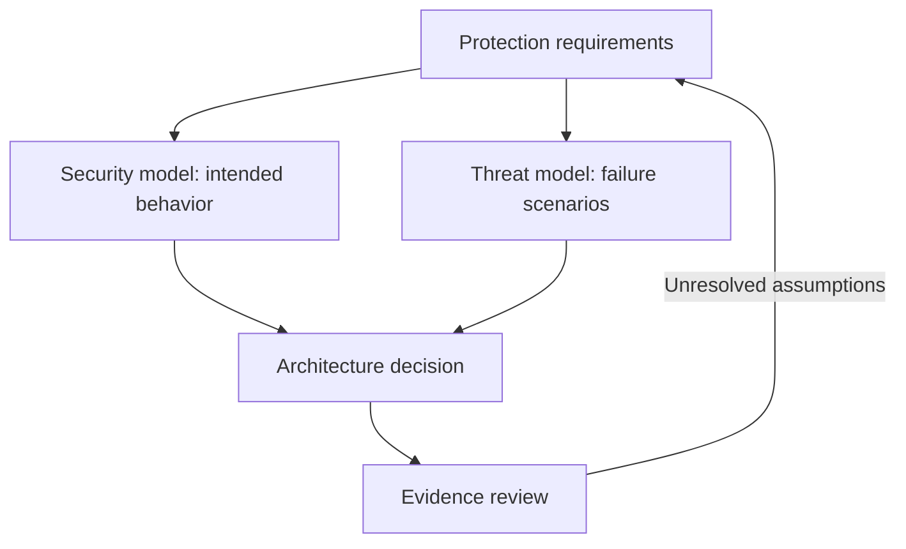

# Modelo Security
### Security engineering with traceable decisions and evidence

**Model the system. Examine the threats. Make the decision. Verify the evidence.**

Modelo Security's public engineering workspace connects architecture, security modeling, threat analysis, and assurance through practical review packages. Start with a working local tool, follow an environment-specific playbook, or explore the companion repositories.

[Website](https://modelosecurity.com) · [Review workflow](docs/review-workflow.md) · [Tool contract](docs/review-package.md) · [Contribute](CONTRIBUTING.md)

## Run the demo

Requires Python 3.10 or later. No installation, API key, account, or network connection is needed.

```bash
git clone https://github.com/secsar/modelosecurity.git
cd modelosecurity
python -m tools.review examples/review-package/package.json
python -m unittest discover -s tests -v
```

The synthetic package deliberately reports **INCOMPLETE: 1 of 3 required items supported by matching records**. It makes missing evidence visible instead of treating a planned control as a completed result.

```bash
python -m tools.review examples/review-package/package.json --format json
python -m tools.review examples/review-package/package.json --strict
```

The strict command intentionally exits 1 for this incomplete fixture. See [exit codes and evidence rules](docs/review-package.md).

## What is available

| Component | You can do today | Boundary |
| --- | --- | --- |
| Evidence readiness tool | Validate a review package, check local artifact hashes, find missing evidence, emit Markdown or JSON | Checks records and traceability; does not assess security effectiveness |
| Review workflow | Connect requirements, models, decisions, and evidence with stable IDs | Human judgment and approval remain explicit |
| Environment playbooks | Review cloud services, AI assistants, and software delivery | Questions and evidence criteria, not automated scanners |
| Worked examples | Inspect a decision record and an intentionally incomplete evidence package | Synthetic material; no customer assessment |
| Companion repositories | Develop security specifications and threat analyses independently | Detailed artifacts stay in their owning repositories |

## Choose a review

| System | Start with | Concrete output |
| --- | --- | --- |
| Tenant-facing application or cloud service | [Cloud and tenant isolation](playbooks/cloud-service.md) | Authorization boundaries and revocation evidence |
| AI assistant with tools or retrieval | [AI and agent workflows](playbooks/ai-workflow.md) | Tool authority, provenance, approvals, and evaluation boundaries |
| Build or release pipeline | [Software delivery](playbooks/software-delivery.md) | Source-to-artifact provenance and deployment authorization |
| Any architecture decision | [Security review guide](guides/security-review.md) | Alternatives, tradeoffs, owner, and verification conditions |

## One workflow, distinct disciplines



| Repository | Responsibility |
| --- | --- |
| modelosecurity | Public review workflow, decision records, and evidence-readiness tooling |
| [security-modeling](https://github.com/secsar/security-modeling) | Policy specifications, permitted states, information flow, and security properties |
| [threat-modeling](https://github.com/secsar/threat-modeling) | Threat scenarios, attack paths, prioritization, and mitigations |
| [stephsec-research](https://github.com/secsar/stephsec-research) | Research questions, methods, and evidence synthesis |

## Evidence before claims

The tool is a local prototype. It does not scan networks, call AI models, deploy changes, certify compliance, or authenticate a submitted result. Hash matching checks file integrity relative to a declared digest, not whether the underlying evidence is true. No hosted security product is exposed by this repository.

[Worked decision](examples/document-access-decision.md) · [Evidence example](examples/review-package/README.md) · [Roadmap](docs/roadmap.md) · [Public-content review](docs/public-content-review.md)
